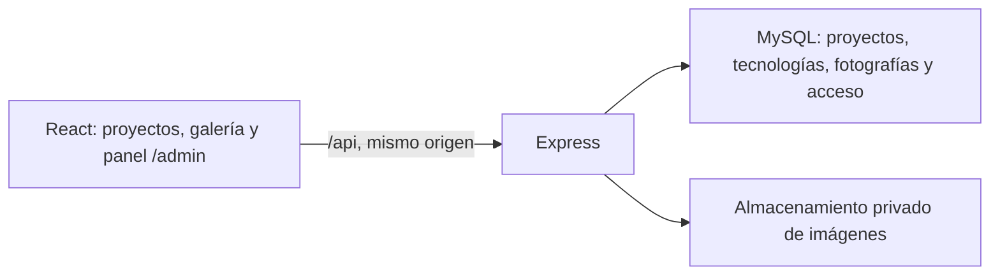

# Backend de proyectos y fotografía

La portada obtiene proyectos y fotografías mediante Express 5 y MySQL/MariaDB; `/admin` permite gestionar ambos recursos. Solo los textos permanecen en un archivo local. Este documento describe la implementación y su preparación para un despliegue; no implica que esté publicada en un servidor de producción.

## Arquitectura

| Ubicación | Responsabilidad |
| --- | --- |
| `server/src/inicio.js` | Comprueba BD, inicia HTTP y cierra recursos al detenerse. |
| `server/src/app.js` | Cabeceras, orígenes, límites, sesiones, rutas y errores. |
| `server/src/modules/auth/` | Contraseñas, sesión MySQL y comprobación de acceso y CSRF. |
| `server/src/modules/fotografias/` | Validación, consultas parametrizadas y CRUD transaccional. |
| `server/src/modules/proyectos/` | CRUD de proyectos, portadas y relaciones ordenadas con tecnologías. |
| `server/src/modules/imagenes/` | Procesamiento y entrega autorizada de archivos. |
| `server/migrations/` | Cambios versionados de esquema. |
| `src/services/api.js`, `src/hooks/useFotografias.js`, `src/hooks/useProyectos.js` | Peticiones del navegador y paginación pública. |
| `src/admin/` | Acceso y secciones de fotografía y proyectos. |
| `server/semillas/proyectos-iniciales.js` | Datos antiguos para importación; no se incluyen como fuente de la portada. |

La API usa un pool de conexiones y una cuenta con permisos DML (`SELECT`, `INSERT`, `UPDATE`, `DELETE`). Las sesiones se guardan en BD, las contraseñas mediante scrypt con sal aleatoria y la cookie es HttpOnly y SameSite Strict. En producción también es Secure. El login cambia el identificador de sesión y renueva el token CSRF.

## Preparación y comandos

Requiere Node 22.12 o posterior y MySQL/MariaDB. La instalación local utiliza XAMPP con MariaDB 10.4 en el puerto 3306.

| Comando | Función |
| --- | --- |
| `npm install` | Instala dependencias de frontend y backend. |
| `npm run configurar:local` | Crea `.env` con secretos aleatorios sin imprimirlos ni sobrescribirlo. |
| `npm run db:preparar` | Crea la base principal, aplica migraciones y concede permisos al usuario de la API. |
| `npm run db:pruebas` | Prepara exclusivamente la base indicada por `DB_TEST_NAME`. |
| `npm run admin:crear` | Crea el usuario de `.env`; conserva una cuenta existente. |
| `npm run proyectos:importar` | Importa una sola vez los cuatro proyectos antiguos, sin sobrescribir slugs existentes. |
| `npm run api` | API en modo observación, por defecto `127.0.0.1:3001`. |
| `npm run dev` | Vite en 5173, con proxy `/api` hacia 3001. |
| `npm run test:api` | Pruebas Node de imágenes, validación y las integraciones de fotografías y proyectos con BD. |
| `npm run comprobar:navegador` | Comprueba la portada con API y Vite activos. |
| `npm run comprobar:admin` | Comprueba el panel con API y Vite activos. |
| `npm run comprobar:proyectos` | Comprueba la gestión de proyectos con API y Vite activos. |
| `npm run build` | Genera el frontend en `dist/`. |
| `npm start` | Inicia Express sin observación; en producción sirve también `dist/`. |

Tras instalar y generar `.env`, inicia MySQL y ajusta las variables de conexión si procede. Ejecuta `db:preparar` y `admin:crear`; usa después `proyectos:importar` si quieres migrar los ejemplos originales. Arranca API y Vite en terminales distintas y abre `/admin` desde Vite. Las credenciales iniciales están en `ADMIN_USUARIO` y `ADMIN_CONTRASENA` del archivo local; no se incluyen aquí ni se imprimen en los comandos.

### Configuración

| Variables | Uso |
| --- | --- |
| `DB_HOST`, `DB_PORT`, `DB_NAME`, `DB_USER`, `DB_PASSWORD` | Conexión de la aplicación; por defecto base `portfolio_react`. |
| `DB_TEST_NAME` | Base separada de integración, por defecto `portfolio_react_pruebas`; no puede coincidir con la principal. |
| `DB_ADMIN_USER`, `DB_ADMIN_PASSWORD` | Cuenta con permisos para crear esquema y conceder permisos; solo la usa el script de preparación. |
| `ADMIN_USUARIO`, `ADMIN_CONTRASENA` | Creación inicial de administrador, no restablecimiento de contraseñas. |
| `SESSION_SECRET` | Firma de sesiones, mínimo 32 caracteres; generado por la configuración local. |
| `HOST`, `PORT` | Dirección de escucha de Express. |
| `APP_ORIGINS` | Lista separada por comas de los orígenes permitidos para escrituras. |
| `SERVER_ENV`, `NODE_ENV`, `TRUST_PROXY` | Modo del servidor y confianza en un proxy inverso. Usa `SERVER_ENV=development` en `.env`; reserva `NODE_ENV=production` para el proceso de despliegue. |

`.env` y `server/storage/` están ignorados por Git; `.env.example` solo contiene la plantilla. Los secretos se leen desde Node, nunca mediante variables `VITE_*`. Cambiar la contraseña en `.env` no modifica una cuenta administrativa ya creada ni la contraseña de un usuario MySQL existente.

El modo del servidor se separa del de Vite: guardar `NODE_ENV=development` en el `.env` compartido haría que una compilación incluyera código de desarrollo de React. En producción, suministra al proceso de la API únicamente los secretos que necesita; las credenciales de preparación de BD y la contraseña inicial del administrador no tienen que permanecer en su entorno habitual.

## Rutas y flujo de acceso

| Método y ruta | Acceso y resultado |
| --- | --- |
| `GET /api/salud` | Comprueba la conexión de BD. |
| `GET /api/fotografias` | Listado público de fotografías publicadas. |
| `GET /api/imagenes/:nombre` | Archivo publicado; un borrador requiere administrador activo. |
| `GET /api/proyectos` | Listado público de proyectos publicados con sus tecnologías. |
| `GET /api/imagenes/proyectos/:nombre` | Portada subida de un proyecto; protege los borradores. |
| `GET /api/admin/sesion` | Estado de sesión y token CSRF; también antes del login. |
| `POST /api/admin/login` | Usuario y contraseña JSON, cookie y cabecera CSRF. |
| `POST /api/admin/logout` | Destruye sesión y cookie; exige CSRF. |
| `GET /api/admin/fotografias` | Listado de todos los estados; exige administrador. |
| `POST /api/admin/fotografias` | Crea desde multipart; exige administrador y CSRF. |
| `PUT /api/admin/fotografias/:id` | Edita metadatos y, opcionalmente, sustituye imagen. |
| `DELETE /api/admin/fotografias/:id` | Borra registro e imagen tras confirmar BD. |
| `GET /api/admin/proyectos` | Listado completo; exige administrador. |
| `POST /api/admin/proyectos` | Crea metadatos y portada subida o URL HTTPS externa. |
| `PUT /api/admin/proyectos/:id` | Edita los campos recibidos, tecnologías y portada opcional. |
| `DELETE /api/admin/proyectos/:id` | Borra proyecto, relaciones e imagen local tras confirmar BD. |

Los listados de ambos recursos admiten `pagina` y `limite`, con un máximo de 50 elementos por petición. El cliente obtiene primero la sesión y envía `X-CSRF-Token` en las operaciones de escritura. El servidor comprueba también el origen, vuelve a verificar que la cuenta siga activa y aplica autenticación y CSRF antes de procesar multipart. No se guardan credenciales de sesión en localStorage.

El proyecto exige título, slug único, categoría y una portada. Puede conservar su imagen actual, subir otra o sustituirla por una URL HTTPS; el backend valida la URL sin descargarla. Las tecnologías se envían como array JSON dentro de multipart y se relacionan mediante `proyecto_tecnologia`. Un slug ocupado responde `409` con `SLUG_DUPLICADO`. Las relaciones se cargan por página en una sola consulta adicional.

El contrato completo de datos, límites de texto y respuestas está en [Contrato de datos](contrato-datos.md).

## Imágenes y consistencia

Cada subida admite un archivo JPEG, PNG o WebP estático de hasta 8 MiB y 25 millones de píxeles. Sharp verifica el contenido real, aplica la orientación, reduce hasta 2400 × 2400 sin ampliar y genera WebP sin metadatos. Los nombres se generan con UUID; no se utiliza el nombre del cliente como ruta.

Los archivos están en `server/storage/fotografias/` y `server/storage/proyectos/`, fuera de los directorios públicos. El segundo directorio corresponde a `directorioImagenesProyectos` en la configuración. No se sirven con `express.static`: cada lectura consulta su recurso y estado en BD, usando tablas y rutas permitidas explícitamente. Un visitante no puede recuperar un borrador por la URL del archivo local. La API y estos archivos envían `Cache-Control: no-store`; publicar y retirar se comprueban en cada nueva petición.

Las portadas externas siguen alojadas en su proveedor: este controla su privacidad, disponibilidad y posibles límites. La API no las descarga, por lo que tampoco genera peticiones de servidor hacia las URL introducidas. Un borrador oculta los datos del proyecto en la API pública, pero no convierte en privada una imagen externa. La política de contenido del frontend permite imágenes HTTPS.

Editar y borrar bloquean la fila con `FOR UPDATE`. Un error conocido de BD provoca un intento de borrar la subida nueva. Los archivos anteriores se eliminan después del commit. MySQL y el disco no comparten una transacción: un cierre inesperado puede dejar archivos huérfanos. Si el resultado del commit es desconocido se conserva la imagen nueva y se responde `503`, evitando borrar un archivo que la BD pudiera estar referenciando. Los fallos de limpieza quedan registrados; todavía no hay un trabajo automático de reconciliación.

## Migraciones, copias y recuperación

`db:preparar` aplica los `.sql` de `server/migrations/` por orden y registra su nombre y huella en `migraciones`. Una migración aplicada no debe editarse: añade otro archivo para el siguiente cambio. El DDL de MySQL confirma implícitamente, por lo que no existe una reversión automática global. El ejecutor actual está pensado para sentencias SQL sencillas.

`001_fotografia_y_acceso.sql` crea fotografía, usuarios y sesiones. `002_gestion_proyectos.sql` añade proyectos, tecnologías, sus relaciones e `importaciones_datos`. Preparar el esquema no importa contenidos automáticamente.

`proyectos:importar` lee exclusivamente la copia de `server/semillas/proyectos-iniciales.js`. Dentro de una transacción omite los slugs ya existentes e incorpora el resto, con sus tecnologías. Guarda el marcador `proyectos_iniciales_v1` en `importaciones_datos`; las siguientes ejecuciones no reintroducen ejemplos eliminados ni cambian ediciones del panel. No hay que modificar o borrar ese marcador para actualizar contenidos: deben editarse desde `/admin`.

Las copias deben incluir **BD y ambos directorios de imágenes del mismo estado**, además de conservar la configuración secreta por un medio privado. El volcado de BD incluye migraciones y marcadores de importación. Para obtener una copia coherente, detén las escrituras durante la captura o utiliza un procedimiento de instantáneas coordinadas. No basta con copiar el repositorio: los archivos subidos y `.env` no forman parte de Git. Las imágenes externas dependen de su proveedor y no se incluyen en estas copias.

Para recuperar, mantén detenidas las escrituras, restaura el volcado de BD y su directorio de imágenes correspondiente, configura la conexión y comprueba permisos. Si la versión de código necesita nuevas migraciones, aplícalas antes de reabrir el panel. Verifica después una imagen publicada, la privacidad de un borrador y el acceso administrativo. Practicar esta restauración es parte de preparar el despliegue.

Las pruebas de integración usan la base separada `DB_TEST_NAME` y archivos temporales; solo eliminan sus registros. Debe ejecutarse antes `npm run db:pruebas`, también después de añadir migraciones. `test:api` incluye la integración de proyectos y sus pruebas unitarias de validación. Los comprobadores de navegador requieren API y Vite activos y un Chrome/Chromium instalado; la integración de API inicia su propio servidor temporal. Los recorridos del panel leen el acceso desde `.env` sin mostrarlo y generan sus propios datos de prueba. Los scripts admiten `PORTFOLIO_URL`, `CHROME_PATH` y la opción `--capturas`.

## Producción y crecimiento

Después de compilar y preparar la BD, `npm start` con `NODE_ENV=production` sirve API, `/`, `/admin` y los recursos de `dist/`. La configuración exige que `APP_ORIGINS` contenga únicamente los orígenes HTTPS reales; la cookie Secure requiere acceso HTTPS. El despliegue debe terminar TLS en el servidor frontal o proxy y dirigir interfaz y `/api` al mismo origen.

Activa `TRUST_PROXY=1` solo cuando hay un proxy inverso de confianza delante de Node y el proceso no acepta conexiones directas de clientes. Monta `server/storage/` con sus dos subdirectorios sobre almacenamiento persistente: una nueva versión o reinicio del contenedor no debe eliminar sus archivos. `npm run preview` no sustituye este servidor ni prepara el backend.

La separación por módulos permite ampliar el panel sin rehacer la portada. Para varias instancias, las sesiones MySQL ya pueden compartirse si utilizan la misma BD y secreto, pero faltan otras decisiones: los límites de peticiones actuales guardan contadores en memoria por instancia y deben usar un almacén compartido; las imágenes necesitan almacenamiento común o un servicio de objetos que mantenga el control de acceso de los borradores. También deben coordinarse migraciones, monitorización y copias. La capacidad debe medirse antes de ampliar réplicas, conexiones o límites.

La comprobación de dependencias del 31 de octubre de 2026 no detecta avisos en los paquetes de producción (`npm audit --omit=dev`). Quedan seis avisos moderados en la cadena de desarrollo de ESLint/minimatch; no se ha forzado un cambio mayor de herramientas para resolverlos.
