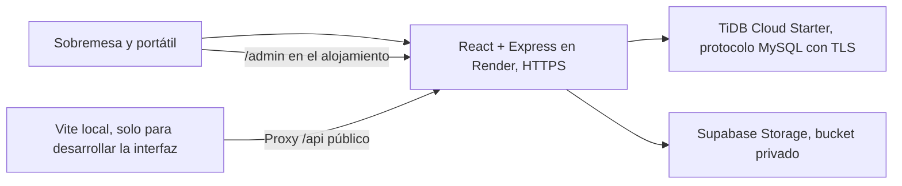

# Datos compartidos entre sobremesa y portátil

Git sincroniza el código. MySQL, las imágenes subidas y los secretos no forman parte del repositorio. Preparar otra base vacía en el portátil permite arrancar la API, pero no recupera el contenido del sobremesa.

La configuración permite conservar el desarrollo local y desplegar una única aplicación compartida:



TiDB conserva los metadatos, las relaciones, los usuarios y las sesiones. Supabase se utiliza **solo para archivos**, no como sustituto de MySQL ni de la autenticación actual. Las imágenes mantienen sus URL `/api/imagenes/...`: Express comprueba si están publicadas o si hay administrador antes de descargarlas del bucket. La clave de Supabase permanece en Node.

## Servicios y límites gratuitos

Condiciones consultadas el 23 de noviembre de 2026; revisar los enlaces antes de crear las cuentas:

| Servicio | Uso | Plan gratuito |
| --- | --- | --- |
| [Render](https://render.com/docs/free) | React compilado, API Express y panel en el mismo origen HTTPS. | Servicio web Free; se suspende tras 15 minutos sin tráfico y puede tardar aproximadamente un minuto en despertar. El disco es temporal. |
| [TiDB Cloud Starter](https://docs.pingcap.com/tidbcloud/select-cluster-tier/) | Base compatible con el protocolo MySQL, usando `mysql2`. | Primeras cinco instancias elegibles: 5 GiB de filas y 50 millones de RU al mes por instancia. El plan gratuito limita el servicio al agotar cuotas. Seleccionar compatibilidad MySQL. |
| [Supabase Free](https://supabase.com/pricing) | Almacenamiento privado de imágenes. | 1 GB de archivos y cuotas de transferencia. Los proyectos gratuitos pueden pausarse tras una semana de inactividad. |

Mantén los planes Free, sin activar ampliaciones de pago. Estas cuotas no equivalen a disponibilidad continua garantizada. El almacenamiento local de Render no sirve para conservar las imágenes entre despliegues; el backend compartido debe usar `IMAGE_STORAGE=supabase`.

## 1. Exportar el contenido del sobremesa

Conserva `.env` y la instalación actuales. Detén `npm run dev` o la API para impedir cambios mientras se copian los archivos; deja MySQL activo. Desde el sobremesa:

```sh
npm run datos:exportar -- .tmp/traslado-portfolio
```

El directorio nuevo contiene un manifiesto y las imágenes referenciadas, con sus huellas SHA256. Incluye proyectos, tecnologías, relaciones, imágenes de detalle, ilustraciones, fotografías y marcadores de importación. No incluye usuarios, contraseñas, sesiones ni `.env`. La exportación no borra ni modifica los datos originales. Guarda esta copia por un medio privado: puede contener borradores y `.tmp/` está excluido de Git.

## 2. Crear la base y el bucket

Estas acciones requieren iniciar sesión en cuentas propias; el repositorio no puede crear esas cuentas ni obtener sus credenciales.

1. En TiDB crea una instancia **Starter, MySQL-compatible** gratuita. En su consola crea la base `portfolio_react` y guarda host, puerto, usuario y contraseña de conexión. Permite la conexión desde el sobremesa para migrar y desde Render para servir la aplicación.
2. En Supabase crea un proyecto Free y un bucket llamado `portfolio` con **Public desactivado**. La API comprueba que el bucket sea privado. No crees políticas de acceso público. En Settings > API Keys obtén la URL del proyecto y una clave de servidor `sb_secret_...`; nunca uses esa clave en variables `VITE_*`. Se siguen admitiendo claves antiguas `service_role` mediante `SUPABASE_SERVICE_ROLE_KEY`, pero las configuraciones nuevas utilizan [secret keys](https://supabase.com/docs/guides/getting-started/api-keys).
3. Copia `.env` a `.env.remoto` mediante el explorador o tu editor. Ambos están ignorados por Git. Ajusta únicamente la copia para el destino:

```dotenv
DB_HOST=host-de-tidb
DB_PORT=4000
DB_NAME=portfolio_react
DB_USER=usuario-de-migracion
DB_PASSWORD=contraseña-del-destino
DB_SSL=1
IMAGE_STORAGE=supabase
SUPABASE_URL=https://identificador.supabase.co
SUPABASE_SECRET_KEY=sb_secret_clave-privada
SUPABASE_STORAGE_BUCKET=portfolio
```

Conserva en esa copia los secretos generados y los demás campos necesarios de `.env`. No la subas al repositorio ni pegues sus valores en conversaciones. Si el proveedor requiere una CA adicional, configura `DB_SSL_CA_FILE`; no se desactiva la comprobación de certificados.

## 3. Preparar e importar el destino

Desde el sobremesa, con la API de destino todavía detenida:

```sh
node --env-file=.env.remoto server/scripts/preparar-base-remota.js
node --env-file=.env.remoto server/scripts/transferir-datos.js importar .tmp/traslado-portfolio
node --env-file=.env.remoto server/scripts/crear-admin.js
```

La preparación remota aplica las mismas migraciones versionadas sobre una base ya creada. No ejecuta `CREATE USER` ni los permisos `@localhost` de XAMPP. La cuenta que prepara el esquema necesita permisos DDL. Para la aplicación habitual utiliza una cuenta con `SELECT`, `INSERT`, `UPDATE` y `DELETE` sobre esa base.

En TiDB también comprueba `tidb_enable_check_constraint`: si está desactivado intenta habilitarlo para conservar las restricciones `CHECK` de las migraciones. Este ajuste afecta a la instancia de TiDB. Si la cuenta de migración no tiene permiso, se detiene antes de aplicar el esquema; habilítalo desde su consola con la cuenta administrativa y repite la preparación.

La importación exige tablas de contenido vacías y verifica los archivos antes de escribir. Sube las imágenes al bucket y conserva los identificadores y relaciones al insertar los datos en una transacción. Nunca vacía una base ni sobrescribe una imagen diferente. Si una subida se interrumpe, los archivos completos iguales pueden reutilizarse al reintentar; se conservan los originales del sobremesa. Si el resultado de un commit no puede confirmarse, revisa el destino antes de repetir: una importación aplicada se detectará como destino ocupado.

El importador mantiene los archivos validados en memoria. Está pensado para el volumen actual del portfolio; una colección mucho mayor necesitaría una transferencia por lotes.

El administrador se crea con `ADMIN_USUARIO` y `ADMIN_CONTRASENA` de `.env.remoto`; no se han copiado las cuentas locales. Crear una cuenta que ya existe conserva su contraseña.

## 4. Desplegar la aplicación

El archivo [`render.yaml`](../render.yaml) declara un servicio web Free sin disco persistente y con las opciones de Node, TLS de BD y Supabase. Puedes usarlo como Blueprint o copiar sus valores al crear un Web Service desde el repositorio:

- Build: `npm ci --include=dev && npm run build`.
- Start: `npm start`.
- Variables de ejecución: las del Blueprint; `APP_ORIGINS` debe ser el origen HTTPS **real** que Render asigne al servicio, sin barra final.
- `HOST=0.0.0.0`, `NODE_ENV=production` y `TRUST_PROXY=1`. Render proporciona `PORT`.
- `DB_*` deben corresponder al destino; `DB_SSL=1` y `IMAGE_STORAGE=supabase`.
- `SESSION_SECRET` debe ser estable entre despliegues. El Blueprint genera uno; no hace falta que coincida con el local.
- No configures las credenciales de migración ni la contraseña inicial del administrador en el servicio habitual; solo la conexión de aplicación y los secretos que necesita la API.

Primero importa los datos y crea el administrador desde el sobremesa: Render Free no ofrece una consola para ejecutar estos comandos. Comprueba después `/api/salud`, una imagen publicada, el acceso a `/admin` y que una imagen en borrador responda 404 sin sesión. La conectividad real con TiDB y Supabase solo queda validada al ejecutar estos pasos con tus cuentas.

## 5. Desarrollar desde cualquiera de los equipos

Para visitar y administrar el portfolio, abre directamente su URL HTTPS. Para desarrollar la interfaz con los mismos datos, en el `.env` local de **cada equipo** configura:

```dotenv
API_PROXY_TARGET=https://nombre-real.onrender.com
```

Y ejecuta:

```sh
npm ci
npm run dev:web
```

Este flujo no necesita XAMPP ni Express en el portátil. Vite dirige las consultas y las imágenes al backend compartido. Al visitar `/admin` redirige al administrador alojado, donde las cookies Secure y la protección CSRF utilizan el origen HTTPS correcto. No se modifican esas protecciones para aceptar un login remoto desde HTTP local.

`API_PROXY_TARGET` configura Vite y su previsualización; no se incrusta en el React compilado. En el servidor publicado Express sirve web y API juntas. `npm run preview` utiliza el proxy configurado, pero no inicia una API.

Para desarrollar cambios del backend o del propio panel antes de publicarlos, conserva una base y archivos de prueba locales, deja `API_PROXY_TARGET` vacío y utiliza `npm run dev` con MySQL. El contenido que se modifica en el panel alojado es compartido por los dos equipos; el código sigue sincronizándose mediante Git.

## Comprobaciones del código

```sh
npm run test:compartido
npm run test:api
npm run lint
npm run build
```

Las pruebas compartidas utilizan servidores y almacenes simulados, archivos temporales y Vite real. No requieren credenciales de servicios externos ni realizan una importación sobre tu base habitual. `test:api` sigue necesitando la base local separada de pruebas. Ninguna prueba local sustituye a comprobar un despliegue real con sus credenciales.
