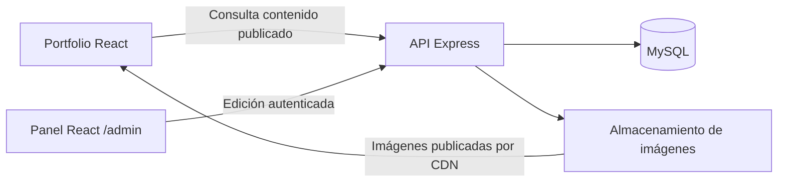

Informe del portfolio React — 29 de octubre de 2026

Este diagnóstico conserva el estado inicial de la revisión. Las correcciones posteriores se recogen en la actualización al final.

La base del proyecto permite evolucionar hacia un portfolio administrable conservando sus componentes y diseño. Actualmente es un portfolio con contenido estático: la interfaz tiene estructura propia e interacciones, pero quedan acciones por completar y todavía no existen API, base de datos ni panel.

**Arquitectura y funcionamiento actuales.** React 19 y Vite 8 montan una única página. `main.jsx` carga Bootstrap 5 y activa `StrictMode`; `App.jsx` compone `Navbar`, `Hero`, `AnimationLab` y `Projects`. Este último recorre los cuatro registros de `src/data/proyectos.js` y los entrega a `ProjectCard`.

Es una separación adecuada entre contenido y presentación. Los componentes son pequeños; el grid personalizado contempla tres, dos y una columnas; las imágenes usan carga diferida. El tema se conserva en `localStorage` y se aplica antes del montaje de React. Los estilos BEM y las variables CSS facilitan mantener la identidad visual.

El estado local y las anclas bastan para esta portada. Añadir rutas tendrá sentido con el panel y las fichas de proyecto. No hay una necesidad actual de gestión global del estado.

**Mejoras prioritarias verificadas.**

| Prioridad | Evidencia | Mejora propuesta |
| --- | --- | --- |
| Alta | `Navbar.jsx:27`, `:31`, `:50` y `:53` contienen comentarios `/* ... */` dentro del JSX; aparecen como texto en la salida compilada. | Usar comentarios JSX `{/* ... */}`. |
| Alta | `Navbar.jsx:11` enlaza a Sobre mí, Fotografía y Contacto, cuyas secciones todavía no existen. `ProjectCard.jsx:44` muestra un botón sin acción. | Completar las secciones y dar a cada proyecto una URL o una ficha accesible mediante enlace. |
| Media | `AnimationLab.jsx:60` crea animaciones continuas; su limpieza solo elimina eventos. | Cancelar o revertir las instancias al recrear el efecto. Comprobarlo también con `StrictMode` y cambios de tamaño. |
| Media | La regla de movimiento reducido en `custom.css:707` desactiva transiciones CSS, pero no las animaciones JavaScript. | Consultar esa preferencia también en el componente y ofrecer una versión estática. |
| Media | `index.html` conserva idioma inglés y título de plantilla; faltan descripción y metadatos sociales. | Personalizar metadatos, usar `lang="es"`, añadir `<main>` y revisar teclado, foco y contraste antes de publicar. |

Además, Montserrat y Merriweather están declaradas, pero no se cargan; el README sigue siendo el de Vite. Conviene resolver ambas cosas. Antes de optimizar dependencias o imágenes, medir el comportamiento en navegador.

**Backend y panel propuestos.** Recomiendo Express con MySQL como una aplicación organizada en módulos: proyectos, fotografía, medios, contenido del sitio y autenticación. Cada módulo separaría rutas, reglas de negocio y acceso a datos. Esta propuesta encaja con el objetivo de practicar CRUD y permite desplegar inicialmente un único backend.

El panel permitiría crear, editar, ordenar, guardar borradores y publicar proyectos y fotografías; también modificar presentación, biografía y enlaces de contacto. La API pública devolvería únicamente contenido publicado. Cada operación administrativa comprobaría permisos en el servidor.

| Datos | Contenido principal |
| --- | --- |
| `proyectos` | Título, descripción, categoría, slug único, URLs, portada, orden, estado y fechas. |
| `tecnologias` y `proyecto_tecnologia` | Tecnologías reutilizables y su relación con los proyectos. |
| `fotografias` | Título, descripción, imagen asociada, texto alternativo, orden y estado. |
| `medios` | Clave del archivo, formato, tamaño y dimensiones. |
| `contenido_sitio` | Campos definidos para presentación, biografía y enlaces. |
| `usuarios_admin` | Identidad, hash de contraseña y estado de acceso. |

Las imágenes quedarían en almacenamiento de objetos y MySQL guardaría sus referencias. Las subidas necesitarían límites de tamaño, validación del contenido real y nombres generados por el servidor. [Referencia: OWASP sobre subida de archivos](https://cheatsheetseries.owasp.org/cheatsheets/File_Upload_Cheat_Sheet.html).

Para un panel del mismo dominio, propondría sesiones con cookies `HttpOnly`, `Secure` y `SameSite`, protección CSRF y almacenamiento persistente compartido. El almacén en memoria predeterminado de Express no es apto para producción. [Express: sesiones](https://expressjs.com/en/resources/middleware/session/), [OWASP: cookies y CSRF](https://cheatsheetseries.owasp.org/cheatsheets/Session_Management_Cheat_Sheet.html).

Añadiría validación en servidor, consultas parametrizadas y límites de intentos de acceso. Las credenciales permanecerían en el backend: las variables `VITE_*` se incluyen en el código del cliente. [Express: seguridad](https://expressjs.com/en/advanced/best-practice-security/), [Vite: variables de entorno](https://vite.dev/guide/env-and-mode.html).

**Implementación gradual y crecimiento.**

1. Corregir navegación y animaciones, cerrar las secciones y definir los contratos de datos.
2. Implementar fotografía de extremo a extremo: migración MySQL, API, autenticación, subida de imágenes y CRUD en el panel. Verificar especialmente permisos y archivos rechazados.
3. Migrar proyectos y textos a la API. Introducir un servicio de datos y hooks con estados de carga, error y vacío; conservar las tarjetas. Al publicar, actualizar o invalidar las cachés para reflejar el contenido sin recompilar la web.
4. Preparar producción: migraciones reproducibles, copias de base de datos y archivos con restauración comprobada, registros de errores y comprobaciones automáticas de compilación, lint y operaciones críticas.

Para crecer, utilizar paginación, índices acordes con las consultas, un pool de conexiones y caché pública. Distribuir imágenes por CDN y compartir sesiones y archivos permitiría añadir instancias de la API si las mediciones lo justifican. El admin se cargaría por separado del código de la portada. [Express: rendimiento y despliegue](https://expressjs.com/en/advanced/best-practice-performance/).

Si más adelante cada proyecto necesita posicionamiento y vista previa propia al compartirlo, evaluaría prerenderizado o renderizado en servidor junto con la actualización del contenido.

**Valoración.** Mantendría React/Vite y desarrollaría Express + MySQL por módulos. El primer hito útil sería publicar una fotografía desde un panel protegido y verla en el portfolio sin editar código. Ese recorrido validaría la arquitectura antes de extenderla. La capacidad real dependerá del alojamiento, volumen de imágenes y tráfico medido.

**Comprobaciones realizadas.** La compilación de producción pasa. ESLint falla por el import no utilizado de `stagger` en `AnimationLab.jsx:2`. La salida contiene aproximadamente 123 kB de JavaScript y 32,8 kB de CSS comprimidos con gzip, sin contar imágenes. La revisión cubre código y compilación; queda pendiente la comprobación visual y funcional en navegador. Solo se ha añadido este informe, sin modificar el código de la aplicación.

**Actualización: primer paso implementado.** Se han corregido los comentarios JSX, completado los destinos de navegación y añadido fichas locales de proyecto. El menú móvil espera a cerrar antes de desplazarse al destino. Las animaciones liberan sus instancias y respetan el movimiento reducido también si se cambia durante la visita. Se han personalizado metadatos, cargado las fuentes y mejorado el foco y el contraste de textos pequeños.

Los componentes y funciones propios utilizan nombres y comentarios en español; se conserva el nombre de los archivos existentes y las APIs externas. Sobre mí y Contacto utilizan Lorem ipsum por indicación del usuario. La galería queda preparada con una colección vacía y el contacto admite correo y enlaces opcionales.

Los contratos locales incluyen identificadores estables, slug, orden, estado de publicación, texto alternativo y URL opcionales. Se documentan en [contrato-datos.md](contrato-datos.md); las equivalencias de funciones están en [guia-funciones.md](guia-funciones.md).

La compilación y ESLint pasan. Las comprobaciones de datos y enlaces pasan; el script `scripts/comprobar-navegador.cjs` supera 19 comprobaciones en Chrome real, con navegación móvil, posición del destino, fichas, foco, tema persistente, tamaños de 320 a 1280 px y movimiento reducido en vivo. El siguiente hito es implementar fotografía con Express, MySQL y panel protegido.

**Cambio posterior en la ficha.** Por decisión del usuario se sustituye el diálogo HTML por el modal oficial de Bootstrap 5. `ProjectDetail.jsx` contiene el modal y `ProjectCard.jsx` lo abre con los atributos de Bootstrap. Se utiliza `btn-close` con `data-bs-dismiss="modal"`; el plugin gestiona Escape, fondo y foco. El tema también configura `data-bs-theme` para adaptar los componentes de Bootstrap. La ficha conserva los datos y el diseño del portfolio.

Esta migración pasa compilación, ESLint y 33 comprobaciones en Chrome real. Se verifican los cuatro proyectos, cierres mediante Escape, X y fondo, retorno del foco, retirada del fondo y del bloqueo de scroll, temas claro y oscuro y desplazamiento interno en móvil con el botón de cierre accesible.
